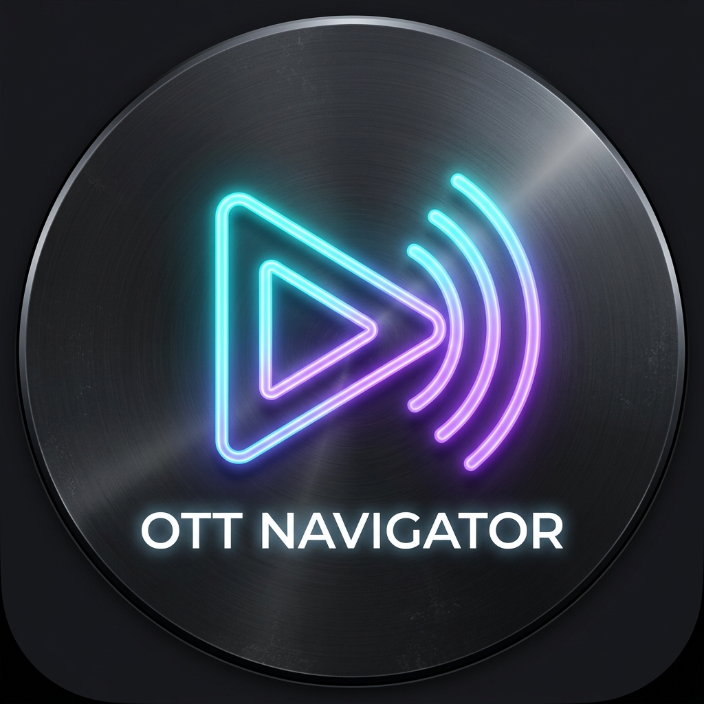

# OTT Navigator for LG webOS TV

A modern, high-performance IPTV media player built specifically for **LG webOS Smart TVs**, inspired by OTT Navigator.



---

## ✨ Features

- **M3U / M3U8 Playlist Engine:** Load remote IPTV playlist URLs or upload local `.m3u` / `.m3u8` playlist files.
- **TV-Optimized Dark UI:** High-contrast OLED dark theme with glowing neon focus states, glassmorphism, and smooth transitions.
- **Full webOS Remote Control Support:**
  - 4-way D-Pad Spatial Navigation (`Up`, `Down`, `Left`, `Right`, `OK / Enter`)
  - LG Magic Remote Pointer & Hover support
  - Native **webOS Back Button** (`Key 461` / `Escape`)
  - **Color button shortcuts:**
    - 🔴 **Red**: Toggle Favorite channel
    - 🟢 **Green**: Switch between Channel Grid and TV Guide (EPG Matrix)
    - 🟡 **Yellow**: Open Playlist & Stream Manager
    - 🔵 **Blue**: Cycle Aspect Ratio (Fit, Cover, Fill)
- **Built-in HLS Live Player:** Powered by Hls.js with automatic bitrate adaptation, audio track selection, and buffering recovery.
- **On-Screen Display (OSD):** Real-time channel metadata, live EPG progress bar, and auto-hiding controls.
- **Quick Channel Zapper:** Slide-out channel list overlay during live video playback for instant channel surfing without stopping your stream.
- **Electronic Program Guide (EPG):** Dynamic timeline grid view (EPG Matrix) with real-time show schedules and progress indicators.
- **Offline / Standalone Ready:** Bundled with local `hls.min.js`, custom icons, and built-in free HD demo channels (NASA TV, Bloomberg, Red Bull TV, DW News, Euronews, France 24, etc.).

---

## 📁 Project Structure

```text
├── appinfo.json         # LG webOS application manifest
├── icon.png             # webOS app launcher icon (80x80)
├── largeIcon.png        # webOS large icon (130x130)
├── index.html           # Main TV application HTML5 interface
├── css/
│   └── style.css        # TV-optimized 1080p/4K responsive stylesheet
├── js/
│   ├── hls.min.js       # Bundled Hls.js library for video streaming
│   ├── m3u-parser.js    # M3U/M3U8 parser & playlist store
│   ├── epg.js           # Electronic Program Guide & Timeline engine
│   ├── player.js        # Video player controller & OSD overlay
│   ├── remote-nav.js    # Spatial navigation & webOS remote key handler
│   └── app.js           # Main application coordinator
```

---

## 🚀 How to Run Locally

To test the application on your computer:
1. Open PowerShell / Command Prompt in this folder.
2. Start a local server:
   ```powershell
   python -m http.server 8085
   ```
3. Open your browser and navigate to:
   ```text
   http://localhost:8085
   ```
4. Test with your keyboard:
   - `Arrow Keys`: Navigate channels & categories
   - `Enter`: Select channel / Play stream
   - `Escape` or `Backspace`: Back / Exit player
   - `R`: Favorite channel
   - `G`: TV Guide (EPG)
   - `Y`: Playlist Manager
   - `B`: Aspect Ratio

---

## 📺 How to Package & Install on LG Smart TV

### Prerequisites
Install the [LG webOS TV SDK (CLI tools)](https://webostv.developer.lge.com/develop/tools/cli-installation):
```bash
npm install -g @webosose/ares-cli
# or install the official LG webOS TV CLI installer
```

### Step 1: Package into an `.ipk` file
Run the `ares-package` command in this folder:
```bash
ares-package .
```
This generates `com.ottnavigator.webos_1.0.0_all.ipk`.

### Step 2: Install onto your LG Smart TV

#### Method A: Using Official LG Developer Mode
1. Install the **Developer Mode** app from the LG Content Store on your TV.
2. Create or log in with an LG Developer account and toggle **Dev Mode ON** and **Key Server ON**.
3. On your PC, connect to your TV via `ares-setup-device`:
   ```bash
   ares-setup-device
   ```
   (Enter your TV's IP address and passkey displayed in the Developer Mode app).
4. Install the package directly to your TV:
   ```bash
   ares-install --device <device_name> com.ottnavigator.webos_1.0.0_all.ipk
   ```

#### Method B: Using webOS Homebrew Channel / webOS Dev Manager
1. If your TV has the [webOS Homebrew Channel](https://github.com/webosbrew/webos-homebrew-channel) or you use [webOS Dev Manager](https://github.com/webosbrew/dev-manager-desktop):
2. Open **webOS Dev Manager** on your PC.
3. Connect to your TV.
4. Click **Install...** and select `com.ottnavigator.webos_1.0.0_all.ipk`.
5. The OTT Navigator icon will appear on your TV's launcher bar ready to launch!
